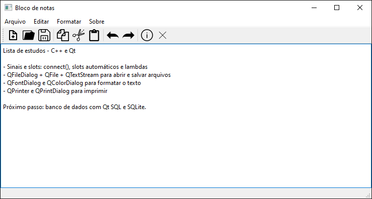
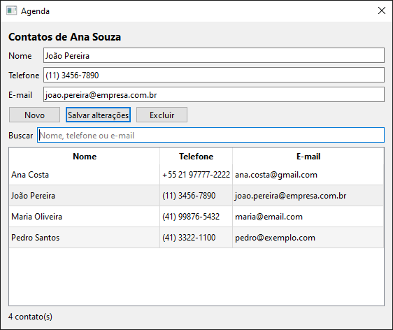
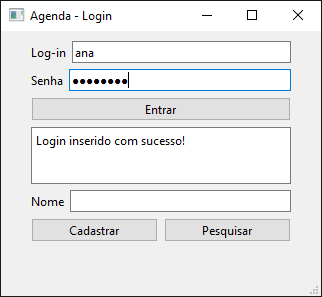
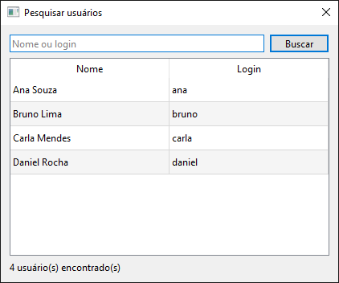
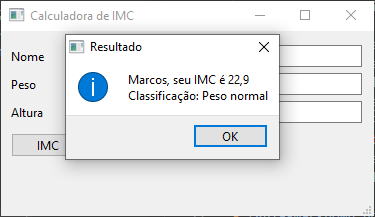

# C++ e Qt: estudos e projetos

Exercícios e projetos que desenvolvi enquanto aprendia C++: programas de console, aplicações desktop com interface gráfica em Qt e exercícios da graduação em Engenharia Elétrica.

## Tecnologias

- **C++** (C++11 em diante)
- **Qt 6** (Qt Widgets e Qt SQL), com **Qt Creator** e qmake: desenvolvido no Qt 6.1.2 e testado no Qt 6.8 LTS
- **SQLite**
- MinGW 64-bit e VS Code

## Projetos em destaque

### Bloco de notas (Qt)

[CFB_Cursos/QT/projetos/bloco_de_notas](CFB_Cursos/QT/projetos/bloco_de_notas/bloco_de_notas)



Editor de texto desktop com menu e barra de ferramentas com ícones.

- Novo, abrir, salvar e salvar como (arquivos `.txt`)
- Copiar, recortar, colar, desfazer e refazer
- Troca da fonte, da cor do texto e da cor de fundo
- Impressão

**Conceitos:** `QMainWindow`, ações de menu ligadas a slots, `QFileDialog`, `QFile` com `QTextStream`, `QFontDialog`, `QColorDialog`, `QPrinter`/`QPrintDialog` e ícones num arquivo de recursos (`.qrc`).

### Agenda de contatos com login (Qt + SQLite)

[CFB_Cursos/QT/banco_de_dados/agenda](CFB_Cursos/QT/banco_de_dados/agenda)



<p>
  
  
</p>

Agenda de contatos com login de usuários e banco SQLite. Cada usuário vê e altera só os próprios contatos.

- **Contatos:** adicionar, editar (clicando na linha da tabela) e excluir, com confirmação antes de excluir. A busca por nome, telefone ou e-mail atualiza a cada letra digitada.
- **Validação:** o nome é obrigatório, o telefone aceita de 8 a 20 números, espaços, parênteses, `+` ou `-`, e o e-mail precisa ter o formato `nome@dominio.ext`.
- **Cadastro de usuários:** exige nome, login e senha e recusa um login que já existe.
- **Senhas protegidas:** o banco guarda só um hash PBKDF2-HMAC-SHA256 com salt aleatório por usuário (100 000 iterações), nunca a senha digitada. A comparação é feita em tempo constante.
- **Consultas parametrizadas** (`prepare` + `bindValue`) em todas as operações, o que impede SQL injection. As alterações e exclusões de contatos também conferem o usuário logado.
- **Pesquisa de usuários** por nome ou login, com os resultados numa tabela. A senha nunca é exibida.
- **Banco criado automaticamente** na pasta de dados do usuário (`%APPDATA%/agenda/logs.db` no Windows), então o app funciona em qualquer computador sem configurar caminhos.

**Conceitos:** módulo Qt SQL (`QSqlDatabase`, `QSqlQuery`, driver `QSQLITE`), `QPasswordDigestor`, `QStandardPaths`, `QRegularExpression`, `QTableWidget` (com o id do registro guardado em `Qt::UserRole`), `QFormLayout` e várias janelas (`QMainWindow` e `QDialog` modal).

### Calculadora de IMC (Qt)

[CFB_Cursos/QT/projetos/imc](CFB_Cursos/QT/projetos/imc/imc)



Calcula o Índice de Massa Corporal a partir do peso e da altura e classifica o resultado pela tabela da OMS. Aceita vírgula ou ponto decimal e altura em metros ou centímetros, e avisa quando um valor não é um número válido.

**Conceitos:** layouts do Qt Designer, conversão de `QString` para número com verificação (`toDouble(&ok)`), `QLocale`, `QMessageBox` e barra de status.

### Jogo da forca (console)

[CFB_Cursos/Exercícios/jogo_forca](CFB_Cursos/Exercícios/jogo_forca)

Um jogador digita a palavra secreta, a tela é limpa e o outro tenta descobri-la letra por letra, com 5 chances de errar. O jogo mostra as letras já tentadas, não desconta chance por uma letra repetida, trata maiúsculas e minúsculas como iguais e termina com vitória ou derrota.

```
Voce tem 4 chances!
Letras tentadas: bxa
Palavra secreta: ba-a-a
Digite uma letra:
n
VOCE VENCEU! A palavra era: banana
```

**Conceitos:** `std::string`, laços, `string::find`, `tolower` e `system("cls")`.

### Relógio (faculdade)

[Exercícios da faculdade/Classes e objetos/relogio](Exercícios%20da%20faculdade/Classes%20e%20objetos/relogio/relogio)

Classe `relogio` que guarda hora, minuto e segundo. O programa lê a hora inicial, avança 3600 segundos e mostra o resultado no formato `HH:MM:SS`, virando minuto, hora e dia corretamente.

**Conceitos:** classes, construtor e destrutor, encapsulamento, separação em `.h` e `.cpp`, projeto qmake de console.

## Conteúdo do repositório

### Curso de C++ (CFB Cursos)

Pasta: [CFB_Cursos/Exercícios](CFB_Cursos/Exercícios) · Playlist: [Curso de C++ no YouTube](https://www.youtube.com/watch?v=nUQKr-ey86Y&list=PLx4x_zx8csUjczg1qPHavU1vw1IkBcm40)

Cada pasta é um programa de console independente sobre um tema.

| Tema | Exercícios |
| --- | --- |
| Fundamentos | variáveis e constantes, operador ternário, `if`/`goto`, `switch`, `while`, `do while`, `for` (incluindo o *range-based for*), *for each*, `printf`/`scanf`, `setlocale`, `system`, `argc`/`argv` |
| Funções | funções, recursão (fatorial e Fibonacci), funções lambda |
| Tipos e dados | `enum`, `struct`, vetores e matrizes, `string`, inicialização uniforme |
| Memória | ponteiros, `malloc`, *smart pointers*, classes de armazenamento (`auto`, `extern`, `register`, `static`) |
| Orientação a objetos | classes, construtor, encapsulamento, *getters* e *setters*, modificadores de acesso, herança, `virtual` e `override`, polimorfismo, C++ moderno |
| Contêineres da STL | `vector`, `list`, `map`, `set`, `pair`, `stack` (pilha), `queue` (fila), `deque`, `array`, iteradores, `find` |
| Biblioteca padrão | [`bibliotecas/`](CFB_Cursos/Exercícios/bibliotecas): `iostream`, `iomanip`, `string`, `cstring`, `cmath`, `cstdlib`, `ctype`, `ctime`, `chrono`, `algorithm`, `functional`, `utility`, `typeinfo`, `fstream` |
| Arquivos e erros | leitura e escrita com `ifstream`, `ofstream` e `fstream`; tratamento de erros com `try`/`catch` |

### Curso de Qt Creator (CFB Cursos)

Pasta: [CFB_Cursos/QT](CFB_Cursos/QT) · Playlist: [Curso de Qt no YouTube](https://www.youtube.com/watch?v=QQDGb4AkY4c&list=PLx4x_zx8csUhzAyii9-cY-IJwo00p_5AC)

Aplicações desktop em Qt Widgets, cada uma num projeto qmake (`.pro`).

| Tema | Projetos |
| --- | --- |
| Primeiros passos | botão e *label*, sinais e slots |
| Widgets | *checkbox*, *radio button*, *combobox* com imagens, *list widget*, abas (*tab widget*) |
| Janelas | barras de menu e de ferramentas, barra de status, caixas de mensagem (incluindo pergunta Sim/Não), várias janelas (formulários), *splash screen* |
| Recursos e imagens | arquivo de recursos (`.qrc`), imagens em `QLabel` |
| Sistema | arquivos de texto, diretórios, `QDesktopServices` (abrir programas externos), `QTimer` |
| Projetos | tela de login com senha oculta, bloco de notas, calculadora de IMC, agenda com SQLite |

> O código-fonte de cinco projetos (calculadora de IMC, variáveis, formulário com objeto global, imagem carregada por código e sinais e slots) se perdeu, e só sobraram os arquivos gerados pelo Qt. Em 2026 recriei esses projetos: as telas foram reconstruídas a partir dos arquivos gerados e a lógica foi reescrita. Os detalhes estão em [DOCS/reconstrucao-projetos-qt.md](DOCS/reconstrucao-projetos-qt.md).

### Exercícios da faculdade

Pasta: [Exercícios da faculdade](Exercícios%20da%20faculdade)

Programas da disciplina de Sistemas Computacionais, da graduação em Engenharia Elétrica. A lista de exercícios está em PDF junto do projeto do relógio.

## Como compilar e executar

**Exercícios de console**, com g++ (MinGW):

```bash
g++ -std=c++17 programa.cpp -o programa.exe
```

Quando a pasta tiver mais de um `.cpp` (por exemplo `Classes de armazenamento/extern`), compile todos juntos. Os exercícios de arquivos abrem `dados.txt` pelo caminho relativo, então devem ser executados de dentro da própria pasta.

**Projetos Qt:** abra o arquivo `.pro` no Qt Creator (Qt 6 com o kit MinGW 64-bit) e execute. Pela linha de comando, rode a partir de uma pasta de build:

```bash
qmake caminho/do/projeto.pro
mingw32-make
```

Todos os projetos compilam com Qt 6.8.3 e MinGW 13.1. O Qt não aceita caminhos com acentos ou caracteres especiais, então copie para um caminho simples os projetos que estiverem em pastas assim, como o relógio em `Exercícios da faculdade`. O exemplo `QT/arquivos` usa um caminho absoluto no código, que precisa ser ajustado para a sua máquina.

## Anotações de estudo

### `#include` com aspas ou com `< >`

Ao incluir arquivos de cabeçalho, usamos a sintaxe `" "` (aspas) ou `< >` (colchetes angulares). Com `< >`, o pré-processador procura o cabeçalho nos locais usuais dos cabeçalhos do sistema. Com `" "`, ele procura primeiro no diretório do arquivo atual e só depois nos locais usuais do sistema.

### Strings

O texto pode ser representado por dois tipos: caracteres (`char`) e strings (`string`). Um `char` guarda um único caractere e é escrito entre aspas simples (`'a'`). Uma `string` guarda uma sequência de caracteres e é escrita entre aspas duplas (`"texto"`).

### Listas

Em C++, listas são sequências ordenadas de valores do mesmo tipo. Para criá-las, é preciso informar o tipo dos elementos. Por exemplo, uma lista de inteiros:

```cpp
list<int> numbers_list({1, 10, 100, 1000});
```

E uma lista de `string`:

```cpp
list<string> vocals_list({"a", "e", "i", "o", "u"});
```

⚠️ Listas em C++ não são tão fáceis de imprimir quanto em outras linguagens: é preciso percorrer a lista com um laço e imprimir os itens um por um.

#### Manipulação de listas

Listas são úteis porque o espaço de memória que ocupam pode crescer e diminuir dinamicamente. Elas têm funções próprias para, por exemplo, inserir um item no início ou no final:

```cpp
numbers_list.push_front(0);     // insere no início
numbers_list.push_back(3000);   // insere no final
```

A lista `numbers_list` fica assim:

```
0, 1, 10, 100, 1000, 3000
```

#### Concatenar listas

Também é possível juntar uma lista ao final de outra, aumentando a primeira sem apagar a segunda. Para isso, usamos a função `insert()`:

```cpp
list<int> new_list({5, 50, 500});

numbers_list.insert(numbers_list.end(), new_list.begin(), new_list.end());
```

A lista `numbers_list` passa a ser:

```
0, 1, 10, 100, 1000, 3000, 5, 50, 500
```

## Licença

[MIT](LICENSE)
