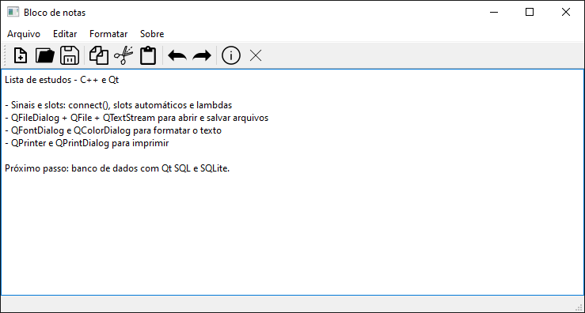
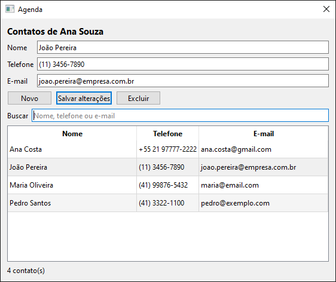
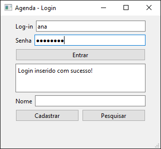
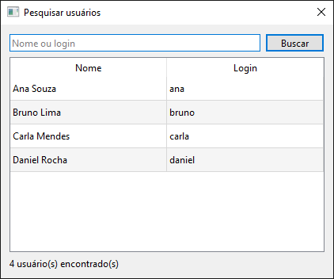
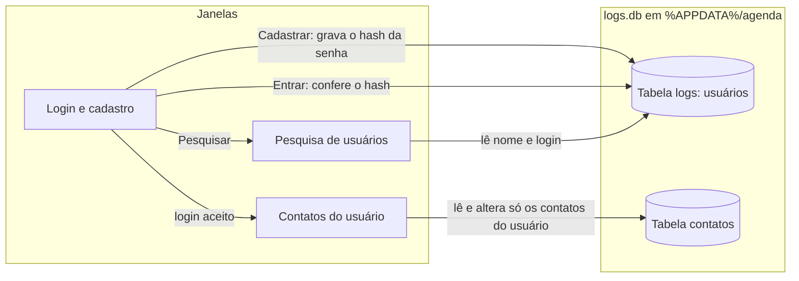
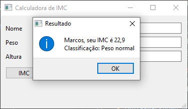

# C++ e Qt: estudos e projetos

Este repositório reúne o que programei enquanto aprendia C++: programas de console, aplicações desktop com interface gráfica em Qt e um exercício da graduação em Engenharia Elétrica. Primeiro aparecem os cinco projetos mais completos, com capturas de tela e os conceitos que cada um usa. Depois vêm os temas estudados em cada curso e um passo a passo para compilar qualquer pasta no Windows.

## Índice

- [Tecnologias](#tecnologias)
- [Projetos em destaque](#projetos-em-destaque)
  - [Bloco de notas](#bloco-de-notas)
  - [Agenda de contatos com login](#agenda-de-contatos-com-login)
  - [Calculadora de IMC](#calculadora-de-imc)
  - [Jogo da forca](#jogo-da-forca)
  - [Relógio](#relógio)
- [Conteúdo do repositório](#conteúdo-do-repositório)
  - [Curso de C++ da CFB Cursos](#curso-de-c-da-cfb-cursos)
  - [Curso de Qt Creator da CFB Cursos](#curso-de-qt-creator-da-cfb-cursos)
  - [Exercícios da faculdade](#exercícios-da-faculdade)
- [Como compilar e executar](#como-compilar-e-executar)
  - [Pré-requisitos](#pré-requisitos)
  - [Baixar o repositório](#baixar-o-repositório)
  - [Preparar o terminal](#preparar-o-terminal)
  - [Compilar um exercício de console](#compilar-um-exercício-de-console)
  - [Compilar um projeto Qt](#compilar-um-projeto-qt)
  - [Erros comuns](#erros-comuns)
- [Anotações de estudo](#anotações-de-estudo)
- [Licença](#licença)

## Tecnologias

- **C++**: os exercícios de console compilam com C++14 ou mais novo (dois deles, `bibliotecas/algorithm` e `bibliotecas/Deque (fila dupla)`, não compilam em C++11). Os projetos Qt usam C++17, o mínimo exigido pelo Qt 6.
- **Qt 6** (Qt Widgets e Qt SQL), com Qt Creator e qmake. Os projetos foram feitos no Qt 6.1.2 e testados de novo no Qt 6.8.3.
- **SQLite**, pelo driver `QSQLITE` do Qt.
- **Windows**, com MinGW-w64 (g++ 13.1) e VS Code.

## Projetos em destaque

### Bloco de notas

Qt Widgets · [CFB_Cursos/QT/projetos/bloco_de_notas/bloco_de_notas](CFB_Cursos/QT/projetos/bloco_de_notas/bloco_de_notas)



Editor de texto desktop com menu e barra de ferramentas com ícones.

- Novo, abrir, salvar, salvar como (arquivos `.txt`) e fechar
- Copiar, recortar, colar, desfazer e refazer
- Troca da fonte, da cor do texto e da cor de fundo
- Impressão

**Conceitos:** `QMainWindow`, ações de menu ligadas a slots, `QFileDialog`, `QFile` com `QTextStream`, `QFontDialog`, `QColorDialog`, `QPrinter`/`QPrintDialog` e ícones num arquivo de recursos (`.qrc`).

### Agenda de contatos com login

Qt Widgets e SQLite · [CFB_Cursos/QT/banco_de_dados/agenda](CFB_Cursos/QT/banco_de_dados/agenda)



<p>
  
  
</p>

Agenda de contatos com login de usuários e banco SQLite. Cada usuário vê e altera só os próprios contatos.

- Os contatos podem ser adicionados, editados (clicando na linha da tabela) e excluídos, com confirmação antes de apagar. A busca por nome, telefone ou e-mail filtra a tabela a cada letra digitada.
- O nome é obrigatório. Telefone e e-mail são opcionais, mas, se preenchidos, são validados: o telefone aceita de 8 a 20 caracteres entre números, espaços, parênteses, `+` e `-`, e o e-mail precisa ter o formato `nome@dominio.ext`.
- No cadastro de usuários, nome, login e senha são obrigatórios, e um login que já existe é recusado.
- O banco não guarda a senha digitada, só um hash PBKDF2-HMAC-SHA256 com salt aleatório por usuário e 100 000 iterações (valores definidos em [senha.cpp](CFB_Cursos/QT/banco_de_dados/agenda/senha.cpp)). Na hora do login, a comparação dos hashes leva sempre o mesmo tempo, para não dar pistas a quem tenta adivinhar a senha.
- Todas as consultas usam parâmetros (`prepare` + `bindValue`), então o texto digitado nunca vira parte do comando SQL, o que impede SQL injection. Editar e excluir um contato também conferem se ele pertence ao usuário logado.
- A pesquisa de usuários busca por nome ou login e mostra o resultado numa tabela, sem exibir a senha.
- O banco é criado na primeira execução, na pasta de dados do usuário (`%APPDATA%/agenda/logs.db` no Windows), então o app roda em qualquer computador sem ajustar caminhos.

O diagrama mostra como as três janelas usam as duas tabelas do banco:



Comece pela janela de login, a primeira a abrir. Os botões Cadastrar e Entrar usam a tabela `logs`, e o botão Pesquisar abre a pesquisa de usuários, que lê a mesma tabela. Quando o hash da senha confere, a janela de contatos abre e passa a trabalhar só com as linhas da tabela `contatos` que pertencem a esse usuário. Os detalhes de segurança e todas as consultas SQL estão em [DOCS/agenda.md](DOCS/agenda.md).

**Conceitos:** módulo Qt SQL (`QSqlDatabase`, `QSqlQuery`, driver `QSQLITE`), `QPasswordDigestor`, `QStandardPaths`, `QRegularExpression`, `QTableWidget` (com o id do registro guardado em `Qt::UserRole`), `QFormLayout` e várias janelas (`QMainWindow` e `QDialog` modal).

### Calculadora de IMC

Qt Widgets · [CFB_Cursos/QT/projetos/imc/imc](CFB_Cursos/QT/projetos/imc/imc)



Calcula o Índice de Massa Corporal pela fórmula IMC = peso ÷ altura² e classifica o resultado pelas faixas da OMS: abaixo de 18,5 é "Abaixo do peso", de 18,5 a menos de 25 é "Peso normal", e daí em diante vêm sobrepeso e obesidade graus I, II e III. Com 70 kg e 1,75 m, por exemplo, o IMC é 70 ÷ (1,75 × 1,75) = 70 ÷ 3,0625 ≈ 22,9, "Peso normal". O app aceita vírgula ou ponto decimal e altura em metros ou centímetros, e avisa quando um valor não é um número positivo.

**Conceitos:** layouts do Qt Designer, conversão de `QString` para número com verificação (`toDouble(&ok)`), `QLocale`, `QMessageBox` e barra de status.

### Jogo da forca

Console · [CFB_Cursos/Exercícios/jogo_forca](CFB_Cursos/Exercícios/jogo_forca)

Um jogador digita a palavra secreta, a tela é limpa e o outro tenta descobri-la letra por letra. Cada letra errada gasta uma das 5 chances. O jogo mostra as letras já tentadas, não desconta chance quando uma letra se repete, trata maiúsculas e minúsculas como iguais e termina com vitória ou derrota.

Esta é a última tela de uma partida com a palavra `banana`, depois das letras b, x (a única errada) e a. O jogador digita `n` e vence:

```
Voce tem 4 chances!
Letras tentadas: bxa
Palavra secreta: ba-a-a
Digite uma letra:
n
VOCE VENCEU! A palavra era: banana
```

**Conceitos:** `std::string`, laços, `string::find`, `tolower` e `system("cls")`.

### Relógio

Console, exercício da faculdade · [Exercícios da faculdade/Classes e objetos/relogio/relogio](Exercícios%20da%20faculdade/Classes%20e%20objetos/relogio/relogio)

A classe `relogio` guarda hora, minuto e segundo. O programa lê a hora inicial, chama 3600 vezes o método que avança um segundo (ou seja, avança uma hora) e mostra a hora antes e depois, no formato `HH:MM:SS`. Os segundos viram minuto ao chegar a 60, os minutos viram hora, e depois de 23:59:59 o relógio volta para 00:00:00. Começando em 23:59:59, a saída é esta:

```
digite o valor da hora:23
digite o valor do minuto:59
digite o valor do segundo:59
Hora Atual: 23:59:59
Hora Atual: 00:59:59
```

**Conceitos:** classes, construtor e destrutor, encapsulamento, separação em `.h` e `.cpp` e projeto qmake de console.

## Conteúdo do repositório

### Curso de C++ da CFB Cursos

Pasta: [CFB_Cursos/Exercícios](CFB_Cursos/Exercícios) · Playlist: [Curso de C++ no YouTube](https://www.youtube.com/watch?v=nUQKr-ey86Y&list=PLx4x_zx8csUjczg1qPHavU1vw1IkBcm40)

São 75 programas de console, em 74 pastas, cada uma sobre um tema. Quase toda pasta tem um único arquivo `.cpp`. Só duas fogem disso: a pasta de recursão (`função recurssiva_fibbonaci e fatorial`) tem dois programas, `fibonacci.cpp` e `fatorial.cpp`, e a `Classes de armazenamento/extern` tem um programa dividido em dois arquivos. A contagem considera como programa cada arquivo `.cpp` com uma função `main()`.

| Tema | Exercícios |
| --- | --- |
| Fundamentos | variáveis e constantes, operador ternário, `if`/`goto`, `switch`, `while`, `do while`, `for` (incluindo o *range-based for*), *for each*, `printf`/`scanf`, `setlocale`, `system`, `argc`/`argv` |
| Funções | funções, recursão (fatorial e Fibonacci), funções lambda |
| Tipos e dados | `enum`, `struct`, vetores e matrizes, `string`, inicialização uniforme |
| Memória | ponteiros, `malloc`, *smart pointers*, classes de armazenamento (`auto`, `extern`, `register`, `static`) |
| Orientação a objetos | classes, construtor, encapsulamento, *getters* e *setters*, modificadores de acesso, herança, `virtual` e `override`, polimorfismo, C++ moderno |
| Contêineres da STL | `vector`, `list`, `map`, `set`, `pair`, `stack` (pilha), `queue` (fila), `deque`, `array`, iteradores, `find` |
| Biblioteca padrão | [`bibliotecas/`](CFB_Cursos/Exercícios/bibliotecas): `iostream`, `iomanip`, `string`, `cstring`, `cmath`, `cstdlib`, `ctype`, `ctime`, `chrono`, `algorithm`, `functional`, `utility`, `typeinfo`, `fstream` |
| Arquivos e erros | leitura e escrita com `ifstream`, `ofstream` e `fstream`; tratamento de erros com `try`/`catch` |

### Curso de Qt Creator da CFB Cursos

Pasta: [CFB_Cursos/QT](CFB_Cursos/QT) · Playlist: [Curso de Qt no YouTube](https://www.youtube.com/watch?v=QQDGb4AkY4c&list=PLx4x_zx8csUhzAyii9-cY-IJwo00p_5AC)

Aplicações desktop em Qt Widgets, num total de 27 projetos qmake (arquivos `.pro`).

| Tema | Projetos |
| --- | --- |
| Primeiros passos | botão e *label*, sinais e slots, variáveis (texto convertido em número) |
| Widgets | *checkbox*, *radio button*, *combobox* com imagens, *list widget*, abas (*tab widget*) |
| Janelas | barras de menu e de ferramentas, barra de status, caixas de mensagem (incluindo pergunta Sim/Não), várias janelas (formulários), *splash screen* |
| Recursos e imagens | arquivo de recursos (`.qrc`), imagens em `QLabel` |
| Sistema | arquivos de texto, diretórios, `QDesktopServices` (abrir programas externos), `QTimer` |
| Projetos | tela de login com senha oculta, bloco de notas, calculadora de IMC, agenda com SQLite |

> O código-fonte de cinco projetos (calculadora de IMC, variáveis, formulário com objeto global, imagem carregada por código e sinais e slots) se perdeu, e só sobraram os arquivos gerados pelo Qt. Em 2026 recriei esses projetos: as telas foram reconstruídas a partir dos arquivos gerados e a lógica foi reescrita. Os detalhes estão em [DOCS/reconstrucao-projetos-qt.md](DOCS/reconstrucao-projetos-qt.md).

### Exercícios da faculdade

Pasta: [Exercícios da faculdade](Exercícios%20da%20faculdade)

Programas da disciplina de Sistemas Computacionais, da graduação em Engenharia Elétrica. A lista de exercícios está no PDF ao lado do projeto do [relógio](#relógio), o único exercício com código neste repositório.

## Como compilar e executar

Os passos abaixo foram testados em novembro de 2026 no Windows 10, com PowerShell, Qt 6.8.3 e MinGW 13.1. Em Linux e macOS eles não foram testados. Nesses sistemas o comando `cls` não existe, então os exercícios que limpam a tela com `system("cls")`, como a forca, rodam sem limpar a tela.

Nesse teste, todos os programas de console (as 74 pastas do curso e o relógio) passaram na verificação de sintaxe do g++ (`g++ -fsyntax-only`) com C++14 e com C++17. Dos 28 projetos qmake (os 27 do curso de Qt e o relógio), 27 compilaram. O relógio é a exceção, por causa do acento no caminho, e tem um comando próprio em [Compilar um projeto Qt](#compilar-um-projeto-qt).

Siga as etapas na ordem. As três primeiras preparam o ambiente, e as duas seguintes compilam os exercícios de console e os projetos Qt.

### Pré-requisitos

| Programa | Para que serve | Versão testada |
| --- | --- | --- |
| MinGW-w64 (`g++` e `mingw32-make`) | compilar tudo | 13.1 |
| Qt para MinGW 64-bit | compilar os projetos Qt | 6.8.3 |
| Git | baixar o repositório | 2.56 |
| Python | só para instalar o Qt pelo aqtinstall | 3.14 |

Para os exercícios de console basta o MinGW. O Qt e o MinGW podem ser instalados de duas formas:

- **Instalador oficial do Qt**, em [qt.io/download-open-source](https://www.qt.io/download-open-source). Ele exige uma conta Qt gratuita e instala também o Qt Creator. Na lista de componentes, marque o Qt 6.8.3 para MinGW 64-bit e o compilador MinGW 13.1.0 64-bit. A pasta padrão é `C:\Qt`. Esse caminho não foi testado nesta revisão.
- **aqtinstall**, uma ferramenta de linha de comando que baixa os mesmos pacotes sem pedir conta. Ela não instala o Qt Creator, mas é suficiente para compilar pelo terminal. Foi assim que o ambiente de teste foi montado:

  ```powershell
  python -m pip install aqtinstall
  python -m aqt install-qt windows desktop 6.8.3 win64_mingw -O C:\Qt
  python -m aqt install-tool windows desktop tools_mingw1310 qt.tools.win64_mingw1310 -O C:\Qt
  ```

  O segundo comando instala o Qt em `C:\Qt\6.8.3\mingw_64`, e o terceiro instala o MinGW em `C:\Qt\Tools\mingw1310_64`. Quem só quer os exercícios de console pode rodar apenas o primeiro e o terceiro. Os downloads levam alguns minutos.

### Baixar o repositório

No PowerShell, clone o repositório e entre na pasta dele:

```powershell
git clone https://github.com/marcospontoexe/Cpp.git
Set-Location Cpp
```

Os comandos das próximas etapas partem desta pasta, a raiz do repositório.

### Preparar o terminal

O Qt e o MinGW não entram sozinhos no PATH, então o PowerShell ainda não encontra o `g++`, o `qmake` e o `mingw32-make`. Coloque as duas pastas no PATH e crie uma pasta para os executáveis, fora do repositório. Assim os arquivos gerados não aparecem como alterações no git:

```powershell
$env:PATH = "C:\Qt\6.8.3\mingw_64\bin;C:\Qt\Tools\mingw1310_64\bin;" + $env:PATH
$repo = (Get-Location).Path
$saida = "$HOME\build-cpp"
New-Item -ItemType Directory -Force $saida | Out-Null
g++ --version
qmake --version
```

Se instalou o Qt em outra pasta, troque `C:\Qt` pelo caminho usado. As duas últimas linhas confirmam a instalação e devem mostrar algo como:

```
g++.exe (x86_64-posix-seh-rev1, Built by MinGW-Builds project) 13.1.0
...
QMake version 3.1
Using Qt version 6.8.3 in C:/Qt/6.8.3/mingw_64/lib
```

O PATH e as variáveis `$repo` e `$saida` só valem para a janela aberta. Ao abrir outro PowerShell, entre de novo na raiz do repositório e repita esta etapa.

### Compilar um exercício de console

Cada pasta de [CFB_Cursos/Exercícios](CFB_Cursos/Exercícios) é compilada sozinha. Para o jogo da forca:

```powershell
g++ -std=c++17 "CFB_Cursos/Exercícios/jogo_forca/jogo_forca.cpp" -o "$saida\forca.exe"
& "$saida\forca.exe"
```

O jogo começa pedindo `Digite uma palavra secreta:`. As aspas em volta do caminho são necessárias porque muitas pastas têm espaços e acentos no nome.

Quando a pasta tem mais de um arquivo `.cpp` que forma um só programa, como `Classes de armazenamento/extern`, passe todos ao g++ no mesmo comando:

```powershell
g++ -std=c++17 "CFB_Cursos/Exercícios/Classes de armazenamento/extern/main.cpp" "CFB_Cursos/Exercícios/Classes de armazenamento/extern/extern.cpp" -o "$saida\extern.exe"
& "$saida\extern.exe"
```

A saída esperada é `valor de num: 10`. A pasta de recursão é o caso contrário: `fibonacci.cpp` e `fatorial.cpp` são programas separados, cada um com seu `main()`, e devem ser compilados um de cada vez.

Os exercícios de arquivos (`manipulação de arquivos/*` e `bibliotecas/fstream`) abrem o `dados.txt` pelo caminho relativo, então precisam rodar de dentro da própria pasta. Eles também gravam nesse arquivo, que faz parte do repositório: alguns acrescentam linhas a cada execução, outros apagam o conteúdo. Por isso o exemplo termina devolvendo o `dados.txt` à versão original:

```powershell
Set-Location "CFB_Cursos/Exercícios/manipulação de arquivos/ifstream"
g++ -std=c++17 ifstream.cpp -o "$saida\ifstream.exe"
& "$saida\ifstream.exe"
git restore dados.txt
Set-Location $repo
```

O programa grava três linhas no `dados.txt` e depois mostra o arquivo inteiro, que termina com `Arquivo de teste`, `linha dois` e `linha tres`.

### Compilar um projeto Qt

Cada projeto Qt tem um arquivo `.pro`, no padrão `CFB_Cursos/QT/<tema>/<projeto>/<projeto>.pro`. O qmake lê esse arquivo e gera um Makefile, e o `mingw32-make` compila. Faça isso numa pasta fora do repositório: as pastas `build-*` que já estão no repositório foram geradas pelo Qt Creator na época do curso e não devem ser alteradas. Para a calculadora de IMC:

```powershell
New-Item -ItemType Directory -Force "$saida\imc" | Out-Null
Set-Location "$saida\imc"
qmake "$repo\CFB_Cursos\QT\projetos\imc\imc\imc.pro" "CONFIG+=release"
mingw32-make -j8
& .\release\imc.exe
Set-Location $repo
```

A compilação termina sem nenhuma linha com `Error`, e a janela "Calculadora de IMC" abre. Para outro projeto, troque `imc` pelo nome dele na primeira, na segunda e na quinta linha, e o caminho do `.pro` na terceira.

Dois projetos precisam de atenção:

- **Relógio:** o Makefile gerado pelo qmake não aceita o acento de `Exercícios da faculdade`, e o `mingw32-make` para com erro. Compile o código direto com o g++:

  ```powershell
  g++ -std=c++17 "Exercícios da faculdade/Classes e objetos/relogio/relogio/main.cpp" "Exercícios da faculdade/Classes e objetos/relogio/relogio/relogio.cpp" -o "$saida\relogio.exe"
  & "$saida\relogio.exe"
  ```

- **`QT/arquivos`:** a linha 8 de [mainwindow.cpp](CFB_Cursos/QT/arquivos/arquivos/mainwindow.cpp) tem um caminho fixo, do computador onde o projeto foi escrito. Antes de compilar, troque o valor de `local` pelo caminho da pasta [CFB_Cursos/QT/arquivos/testes](CFB_Cursos/QT/arquivos/testes) no seu computador, com `/` no lugar de `\` e terminando em `/`.

Os projetos foram criados no Qt Creator, com o Qt 6.1.2, e também podem ser compilados por ele: abra o `.pro`, escolha o kit "Desktop Qt 6.8.3 MinGW 64-bit" e rode com Ctrl+R. Esse caminho não foi testado nesta revisão. O Qt Creator pede pastas sem espaços e sem caracteres especiais ([CFB_Cursos/QT/Leia-me.txt](CFB_Cursos/QT/Leia-me.txt)), e três pastas não seguem essa regra: `arquivo_de _recurssos`, `sinais_slots(evento_e_acoes)` e `Exercícios da faculdade`. Copie esses projetos para um caminho simples antes de abri-los.

### Erros comuns

| O que aparece | Causa | Solução |
| --- | --- | --- |
| `O termo 'g++' não é reconhecido` (ou `The term 'g++' is not recognized`) | O PATH desta janela do PowerShell não tem as pastas do MinGW e do Qt. | Repita a etapa [Preparar o terminal](#preparar-o-terminal). |
| Fora do terminal preparado, o `.exe` fecha sem mostrar nada, ou o Windows avisa que não encontrou `libstdc++-6.dll` ou `Qt6Core.dll`. | O programa depende de DLLs do MinGW e do Qt, que só são encontradas pelo PATH configurado. | Rode pelo terminal preparado. Para levar o programa a outro lugar, compile os exercícios de console com `-static`, e, nos projetos Qt, rode `windeployqt release\imc.exe` na pasta de build, que copia as DLLs para junto do executável (troque `imc` pelo nome do projeto). |
| Um `dados.txt` novo aparece na pasta onde você estava, por exemplo na raiz do repositório. | Um exercício de arquivos foi executado fora da própria pasta. | Apague esse arquivo e rode o exercício de dentro da pasta dele, como no exemplo do `ifstream`. |
| `Cannot find file: ...relogio.pro` e `mingw32-make: *** [Makefile:255: Makefile] Error 2` | O acento de `Exercícios da faculdade` quebra o Makefile gerado pelo qmake. | Compile o relógio com o g++, como em [Compilar um projeto Qt](#compilar-um-projeto-qt). |
| No `QT/arquivos`, os botões que gravam e leem o arquivo avisam que não foi possível abri-lo. | O caminho fixo da linha 8 de `mainwindow.cpp` não existe no seu computador. | Troque o valor de `local`, como explicado em [Compilar um projeto Qt](#compilar-um-projeto-qt). |

## Anotações de estudo

### Cabeçalhos: aspas ou colchetes angulares

Um `#include` pode usar colchetes angulares (`#include <iostream>`) ou aspas (`#include "classes.h"`). Com `< >`, o pré-processador procura o cabeçalho nas pastas do compilador e do sistema. Com aspas, ele procura primeiro na pasta do arquivo que está sendo compilado e só depois nessas pastas. Por isso exercícios como `objetos/herança` incluem os próprios cabeçalhos com aspas (`#include "classes.h"`).

### Caracteres e strings

Um `char` guarda um único caractere e é escrito entre aspas simples (`'a'`). Uma `string` guarda uma sequência de caracteres e é escrita entre aspas duplas (`"texto"`). A `string` cresce conforme o texto, ao contrário de um vetor de `char` (`char palavra[20]`), que tem tamanho fixo. Foi por isso que o jogo da forca trocou os vetores de `char` por `string`.

### Listas

Uma `list` guarda uma sequência ordenada de valores do mesmo tipo, e o tipo dos elementos vai entre `< >` na criação. Os exemplos abaixo usam `#include <list>`, `#include <string>` e `using namespace std;`. Uma lista de inteiros:

```cpp
list<int> numbers_list({1, 10, 100, 1000});
```

E uma lista de `string`:

```cpp
list<string> vocals_list({"a", "e", "i", "o", "u"});
```

Não dá para imprimir a lista inteira com um único `cout`, como se faz com o `print` do Python. É preciso percorrê-la com um laço e imprimir item por item:

```cpp
for (int n : numbers_list)
    cout << n << ", ";
```

#### Manipulação de listas

A lista cresce e diminui conforme itens entram e saem, e tem funções próprias para inserir no início e no fim:

```cpp
numbers_list.push_front(0);     // insere no início
numbers_list.push_back(3000);   // insere no final
```

A lista `numbers_list` fica assim:

```
0, 1, 10, 100, 1000, 3000
```

#### Concatenar listas

Para juntar uma lista ao final de outra, use a função `insert()`. A primeira lista cresce, e a segunda continua igual:

```cpp
list<int> new_list({5, 50, 500});

numbers_list.insert(numbers_list.end(), new_list.begin(), new_list.end());
```

A lista `numbers_list` passa a ser:

```
0, 1, 10, 100, 1000, 3000, 5, 50, 500
```

## Licença

[MIT](LICENSE)
